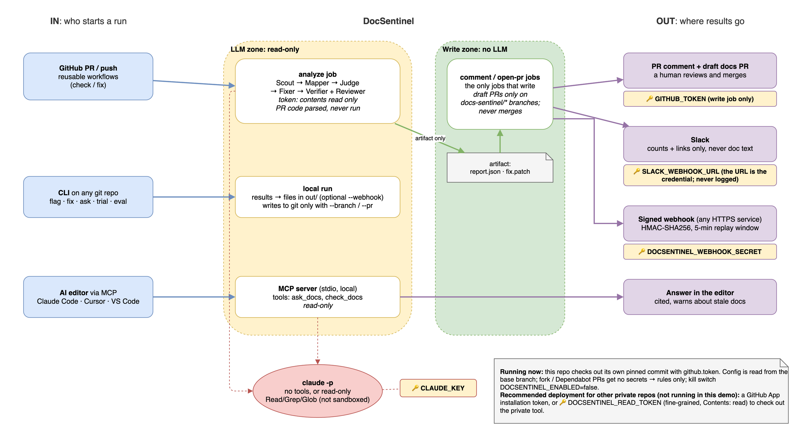

# DocSentinel: write-up

**Problem.** Code changes, docs don't, and readers find out when an example fails.
**DocSentinel** flags the doc sections a code change made wrong, proposes a verified fix as a **draft PR that a human approves**, and gives developers a **Docs Concierge** agent that answers "how do I…?" from docs checked against today's code. Example repo: [python-dotenv](https://github.com/theskumar/python-dotenv) (~8.9k★). Proof and links: **[evidence](evidence.md)**.

**Glossary**
- **STALE**: a doc section now contradicts the code; it gets a fix in the draft PR.
- **REVIEW**: the AI Judge thinks the section is wrong but is unsure (confidence below 0.7); it gets a suggested fix marked "low confidence".
- **CHECK**: the section mentions changed code but wasn't judged (no AI available, or the per-run cap was reached); a human should look.
- **GAP**: a new public function, option or env var that no doc mentions.
- **The four AI roles**: *Drift Judge* (is this section wrong?), *Doc Fixer* (proposes line edits), *Fix Reviewer* (is the fix's meaning right?), *Docs Concierge* (answers developer questions from docs and code).
- **Replay**: recorded AI answers, used when there's no key or CLI, so every run is reproducible at no cost.

## 1. The plan

I started from GitHub's `agentics` **update-docs** workflow: one LLM pass over a diff after merge, with no PR-time flag, no code→doc map, and no verification. 
- **Code where an answer is certain, the LLM only for judgement.** The Change Scout (`ast`) and Doc Mapper find *which* doc sections mention changed code; renames are fixed by code.
- **Reasoning never holds write access.** The Drift Judge, Fixer and Fix Reviewer have no tools. The Concierge has read-only tools (Read, Grep, Glob) that start in the repo; their reads are not sandboxed to it. On GitHub, the LLM job gets a read-only token, and a separate no-LLM job does every write (diagram above).
- **A human merges.** "Auto-update" means a verified draft PR, never a commit to `main`.

## 2. Lessons from real repos

| I assumed | The real repo showed | So I changed |
|---|---|---|
| Doc drift comes from signature changes (names, parameters, defaults). | Maintainers rarely change signatures; they change **behaviour**. In 60 python-dotenv commits only one signature changed. | **Behaviour check:** DocSentinel compares what each public function *does* before and after (ignoring formatting, comments, docstrings and type hints). The Judge gets the code diff **and the test diff**. |
| Checking each commit against its own docs is enough. | Judging against the docs *after* a commit hides drift the author fixed in the same commit. | `trial` judges against the docs **before** each commit. It caught 2 of 3 real drift commits (`c715d19` as a gap, `26ff5b7` exactly as the maintainer fixed it) and missed `0b28805`, which reaches the docs only through a caller. |
| Judging a section again at merge gives the same answer as on the PR. | The same section judged twice can disagree. Borderline confidence sits near 0.7, and confidence is **the model's own estimate, not a computed measure**. | **Judge once:** the PR check's verdicts are reused at merge, only from this repo's own workflow, and only if the merged change is exactly the one that was judged and the doc section is unchanged. Consistency eval: clear cases 5/5, borderline 4/5. |
| A low-confidence (REVIEW) section only needs a flag. | "Not sure" shouldn't mean "no help": the REVIEW section in the 26ff5b7 replay had the right section and reason, but the reviewer had no draft to start from. | REVIEW sections also get a suggested fix, listed first in the draft as **⚠️ low confidence** (or `review_sections: comment_only`). Real result: a human merged [draft PR #8](https://github.com/shubhamchitte/python-dotenv/pull/8). It was correct for `load_dotenv` but [missed that `dotenv_values()` also puts `.env` first](evidence.md#human-approved-doc-update-on-a-real-commit-draft-pr-8), which the maintainer's 2020 edit covered. Human review is the last check. |

## 3. Evals, guardrails and tests

`eval` runs 11 hand-written cases, including 3 traps that must flag nothing:

| | Rules only | Rules + LLM Judge |
|---|---|---|
| Precision | 45% | **100%** |
| Recall | 100% | **94%** |
| Traps clean | 2/3 | **3/3** |

Fixes: 15 of 19 stale or REVIEW sections got a fix that passed the Verifier and the Fix Reviewer. 2 were declined by the Fixer and 2 rejected by the Reviewer ([example](evidence.md#guardrail-example-the-second-ai-rejects-a-fix-it-cant-verify)). **`python src/tests/run_all.py` runs 25 tests**, with no network and no LLM:
- bad fixes rejected, including ones that add a new URL or shell command;
- webhook signature, tampering, replay and plain-http handling;
- Slack never carries doc text;
- cap reporting;
- fork PRs running rules-only;
- and the real workflow shell steps against a local git remote: idempotent re-runs, human-edit protection, and merged drafts left alone.

The suite is small and I wrote it myself, so treat it as a health check, not a benchmark.

## 4. Scale

- **Per run:** at most `max_sections_per_run` (default 20) sections go to the LLM. The rest are reported as "N judged, M skipped: cap reached", never dropped silently. A typical PR on python-dotenv used 5–12 calls, about $0.03–0.15. A rename-only PR costs $0, because renames are fixed by code.
- **Large repos:** httpx's 0.28 refactor had 35 candidate sections in one commit, so the cap applies. Rules-only trials over 60 commits take about 1.5 minutes and cost $0.
- **Many repos:** there's no server and no shared state. Each repo runs the pinned reusable workflow in its own runner. For an organisation, the private tool is read with a **GitHub App** installation token (the recommended deployment; not running in this demo) instead of a per-repo token.
- **Concurrent runs:** a newer push cancels an older PR check. Write jobs are grouped per PR and per merge commit, so two fix runs on one draft branch queue instead of racing.

## 5. Known limitations

- **Concierge reads aren't sandboxed:** its Read/Grep/Glob tools start in the repo but aren't restricted to it.
- **URL/shell check is a pattern match:** the Verifier rejects edits that add a new URL/domain or `curl`/`wget`/`| sh`/`pip install`, but an unusual form could slip past; the human review is the backstop.
- **Webhooks are sent unsigned** if no `DOCSENTINEL_WEBHOOK_SECRET` is set (the log says so).
- **Patch paths aren't re-checked** in the write job before `git apply`; only the earlier Verifier limits edits to doc files.
- **Small, self-written evals:** 11 cases, 3 real drift commits, 2 repos.
- **Scope:** Python only (`click` CLIs); docs must name things in code formatting; sections that only mention a *caller* of a changed function are missed; fixes are line-level.
