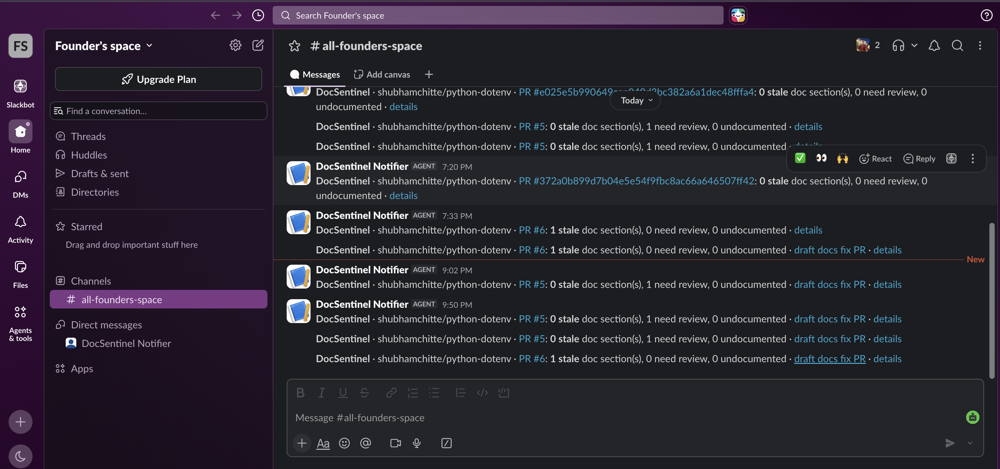

# Evidence: DocSentinel on the real python-dotenv

Everything here ran on [shubhamchitte/python-dotenv](https://github.com/shubhamchitte/python-dotenv), a fork of [theskumar/python-dotenv](https://github.com/theskumar/python-dotenv) (~8.9k★). DocSentinel was installed the way any maintainer would install it (see the README). These are demo results, separate from the eval metrics.

## If you only click three things

1. **Flag and fix on python-dotenv:** the bot's [PR comment](https://github.com/shubhamchitte/python-dotenv/pull/3#issuecomment-6191897504) on a replayed 2020 commit, and the [draft docs PR #4](https://github.com/shubhamchitte/python-dotenv/pull/4) it opened after merge.
2. **Live drift found in httpx:** [`docs/logging.md:25`](https://github.com/encode/httpx/blob/b5addb64f0161ff6bfe94c124ef76f6a1fba5254/docs/logging.md?plain=1#L25) still shows the repr of a class removed in 0.28.
3. **Concierge vs. a stale README:** [the answer](concierge/q4.md) that gives the right value and warns that README lines 44–49 are wrong.

## The trial loop in four links

1. **Install: one commit, two files.** [41a95ec](https://github.com/shubhamchitte/python-dotenv/commit/41a95ec): a 40-line caller workflow pinned to a DocSentinel SHA, plus a 6-line `.docsentinel.yml`. Upgrades are one-line SHA bumps ([9986d77](https://github.com/shubhamchitte/python-dotenv/commit/9986d77), [2f41155](https://github.com/shubhamchitte/python-dotenv/commit/2f41155)).
2. **Flag on a PR.** [PR #3 comment](https://github.com/shubhamchitte/python-dotenv/pull/3#issuecomment-6191897504): replays real commit [26ff5b7](https://github.com/theskumar/python-dotenv/commit/26ff5b7) (2020, "Fix variable expansion order without override") on its parent, with code and tests only. The maintainer's README edit is left out.
3. **Auto-update after merge.** [Draft PR #4](https://github.com/shubhamchitte/python-dotenv/pull/4), opened by the bot. Asking the AI again at merge sometimes gave a different answer than on the PR. Now the merge step reuses the PR's answer, but only if the merged code is exactly what was checked; otherwise it asks again.
4. **Trial report.** Below, judged against the docs from before each commit.
5. **Docs Concierge.** Below: 4 real questions, including one where the README is wrong, plus use through MCP.

**Protected:** [CODEOWNERS](https://github.com/shubhamchitte/python-dotenv/blob/main/.github/CODEOWNERS) requires owner review for `.github/workflows/` and `.docsentinel.yml`. **Uninstall** = delete `.github/workflows/docsentinel.yml`. **Pause instantly** = set the repo variable `DOCSENTINEL_ENABLED=false`.

## What DocSentinel found vs. what the maintainer wrote (26ff5b7)

| | Maintainer (2020) | DocSentinel |
|---|---|---|
| Stale section | Usages: the variable-expansion order | Same section, lines 44–47. It used the code diff and the test diff (env `a=c` vs file `a=b`). |
| Other sections | unchanged | 3 sections judged still correct |
| Fix | Two lists, for `override=True` / `dotenv_values()` and for `override=False` | Labels the default (`override=False`) and corrects the order |
| Verdict | complete | **correct but narrower**: it doesn't add the `override=True` order |

Caveat: this 2020 commit is probably in the model's training data, so part of the match may be memory. The trial below and the eval cases don't have that problem.

## Trial on real history (`docsentinel trial`)

Each commit is checked against the docs **as they were before it** (the parent commit). Otherwise a doc fix the author made in the same commit would hide the drift.

**Last 60 commits, rules only ($0):** 13 commits changed the public API or the behaviour of documented code. 5 doc sections would go to the Judge:

| Commit | Subject | Change | Sections to judge |
|---|---|---|---|
| `0b28805` | expand ~ in find_dotenv and the %dotenv magic | behaviour | 1 |
| `6a49d6d` | name the .env path in set_key / unset_key write errors | behaviour | 1 |
| `e0310e5` | honor --no-override when expanding variables in `dotenv run` | behaviour | 1 |
| `9f3b8b5` | make `dotenv run` forward flags to the given command | behaviour | 1 |
| `3af77d3` | support reading .env from FIFOs | behaviour | 1 |

**With the Judge (`--llm --max-calls 6`):** all 5 were judged ok. That took 5 calls, about $0.05. There were no false alarms in this window.

**Commits where the maintainer also edited the README** (the cases with known drift):

| Commit | What the maintainer added | DocSentinel (docs before the commit) |
|---|---|---|
| `c715d19` (2025, just outside the 60-commit window) | a new section for the new `PYTHON_DOTENV_DISABLED` env var | ✅ **Caught** as a GAP (new public env var, undocumented) |
| `0b28805` (Oct 2026, inside the window) | one example line, `%dotenv ~/path/to/.env` | ❌ **Missed.** The affected text is the `%dotenv` section, which only reaches the changed `find_dotenv` through a caller (the documented caller limitation). Arguably the old text wasn't wrong, only incomplete, but DocSentinel does flag incomplete docs elsewhere (`c715d19`), so I count this as a miss. |
| `26ff5b7` (2020, replayed as PR #3 above) | rewrote the expansion order | ✅ Caught, section and lines match |

**Small sample: 2 of 3 caught.** `0b28805` is the only one of the three that is likely newer than the model's training data, and it's the one DocSentinel missed. The two catches may be helped by memory of the real fixes.

## Docs Concierge on the real repo (`docsentinel ask`, live)

Four questions of different kinds, answered by the agent from the real fork. It searches docs and code with read-only tools. Citations are permalinks at the exact commit that was checked. Full answers are in `docs/concierge/`.

| Kind | Question | README | Concierge answer | Cited code |
|---|---|---|---|---|
| README is right | Load `.env` without overwriting existing env vars? | correct (`override=False` default) | `load_dotenv()`; default `override=False` keeps existing values. Also mentions `dotenv run --no-override`. | [main.py:435](https://github.com/shubhamchitte/python-dotenv/blob/2f41155505559366824a44d6846d7c33ca2136b8/src/dotenv/main.py#L435), [cli.py:188](https://github.com/shubhamchitte/python-dotenv/blob/2f41155505559366824a44d6846d7c33ca2136b8/src/dotenv/cli.py#L188) |
| README doesn't cover it | `dotenv get KEY` with `KEY=`: output and exit code? | not covered | Prints an empty line and exits **0**. It exits 1 only if the key is missing or bare. It also warns that versions before 1.2.4 exited 1. | [cli.py:150–153](https://github.com/shubhamchitte/python-dotenv/blob/2f41155505559366824a44d6846d7c33ca2136b8/src/dotenv/cli.py#L150) |
| Right answer is "no" | Can it load config from YAML? | not covered | **No**: only `KEY=value` parsing, with no YAML code. It suggests parsing with PyYAML and passing the result in via `stream=`. Nothing invented. | [main.py:431](https://github.com/shubhamchitte/python-dotenv/blob/2f41155505559366824a44d6846d7c33ca2136b8/src/dotenv/main.py#L431) |
| **README is stale** | Default `load_dotenv()`, env `FOO=env`, `.env` has `FOO=file`, `BAR=${FOO}`: what is `BAR`? | **wrong** (see below) | **`env`**, and it warns that README lines 44–49 are wrong | [main.py:220–225](https://github.com/shubhamchitte/python-dotenv/blob/0ff65d9ebc5b6dd7557acedadfade99fc105fc0d/src/dotenv/main.py#L220) |

**The stale case, side by side** (at [`0ff65d9`](https://github.com/shubhamchitte/python-dotenv/commit/0ff65d9ebc5b6dd7557acedadfade99fc105fc0d), the replayed 2020 change before the docs were fixed):

| README says ([README.md:44](https://github.com/shubhamchitte/python-dotenv/blob/0ff65d9ebc5b6dd7557acedadfade99fc105fc0d/README.md#L44)) | Concierge answers |
|---|---|
| "The value of a variable is the first of: **value in the `.env` file**, value in the environment, default, empty string." So `BAR` would be `file`. | "**BAR gets `env`.** With the default `override=False`, `os.environ` is applied last in `resolve_variables`, so the environment wins. The .env value wins only with `override=True`." **Warning:** "README.md lines 44-49 … wrong for the default override=False." Cites [main.py:223–225](https://github.com/shubhamchitte/python-dotenv/blob/0ff65d9ebc5b6dd7557acedadfade99fc105fc0d/src/dotenv/main.py#L223). |

The cited lines were checked by hand: lines 223–225 apply `new_values` and then `os.environ` when `override` is false, and `cli.py` lines 150–153 exit 1 only for missing or `None` values. All 4 answers passed the automatic post-checks (cited files and lines exist, and imports exist in the code). The 4 questions cost about $0.45 in total.

**From an AI editor (MCP).** `claude -p` was given the DocSentinel MCP server pointed at the fork, then asked in plain English "Can it load config from a YAML file?". It chose `ask_docs` by itself and answered "No…" with no permission prompts, 3 turns, in 17 s. The server only exposes read-only tools (`ask_docs`, `check_docs`) and runs locally over stdio. Setup:

```json
{"mcpServers": {"docsentinel": {
  "command": "docsentinel",
  "args": ["mcp", "--repo", "/path/to/python-dotenv"],
  "env": {"CLAUDE_KEY": "…"}
}}}
```
(`claude mcp add docsentinel -- docsentinel mcp --repo /path/to/repo` does the same. This needs `pip install "docsentinel[mcp] @ git+…@<SHA>"`.)

## Second repo: encode/httpx (overfitting check)

**Same commit, only config differs.** DocSentinel was installed from the same commit with no code changes. [httpx](https://github.com/encode/httpx) (~13k★) has a different layout: the package is in `httpx/` (not `src/`), the docs are 18 Markdown pages under `docs/`, and the CLI is a single click command. The only input was this config:

```yaml
code: ["httpx/*.py", "httpx/**/*.py"]
docs: ["README.md", "docs/*.md", "docs/**/*.md"]
exclude: ["CHANGELOG*", "tests/**", "docs/code_of_conduct.md"]
cli_name: httpx
```

**Trial, last 60 commits, docs from before each commit:**
- 16 commits changed the public API or the behaviour of documented code.
- 6 sections were STALE by rule. All 6 are in the 0.28 SSL refactor (`8e36f2b`, `1805ee0`), which removed `SSL_CERT_FILE`/`SSL_CERT_DIR` handling and `httpx.SSLContext`.
- 1 GAP and 70 candidate sections. With `--llm --max-calls 8`, the Judge cleared all 8 sections it judged as ok ($0.12). The large refactor commits have more candidates than the per-run cap (20), so a real run would judge 20 and report the rest as unjudged.

**Checked against what the maintainers did:**
- 5 of the 6 STALE sections were **rewritten or removed by the maintainers in the same commits**. These are true positives that the same-commit doc fixes would otherwise have hidden.
- The 6th is **still in httpx's docs today** (checked at [`b5addb6`](https://github.com/encode/httpx/commit/b5addb64f0161ff6bfe94c124ef76f6a1fba5254)). [`docs/logging.md:25`](https://github.com/encode/httpx/blob/b5addb64f0161ff6bfe94c124ef76f6a1fba5254/docs/logging.md?plain=1#L25) shows `ssl_context=SSLContext(verify=True)`, the repr of the removed `httpx.SSLContext` class, which current httpx can't produce. It's minor (a sample log line), but it's real drift that nobody fixed. These commits are probably newer than the model's training data, and these 6 findings came from rules, not the LLM.

**What it showed about generality:**
- The CLI is detected only for `click` (not argparse or typer).
- A single-command click CLI is labelled by its function name (`main`). Options still match (`--method` etc.).
- `cli_name` and the paths come from config. There is no `init` to auto-detect them yet.

## Slack notification (non-GitHub connection)

The fork has the secret `SLACK_WEBHOOK_URL`. The **write jobs** (no LLM) post after each PR check, each merge, and each fix-mode re-run. Every post returned HTTP 200. The logs show only `hooks.slack.com`; the full URL appears 0 times. Runs with nothing to report (all counts 0) no longer post by default (`notify_slack: changes`; set `always` to post every run). Direct pushes are labelled `commit <short SHA>`.



*What the screenshot shows (the channel's full log, unedited):*
- **PR #5, real 26ff5b7 replay: "1 need review".** Correct section and correct reason, but confidence 0.60 < 0.7, so it was marked low confidence for human review. An earlier run of the same commit was STALE ([draft PR #4](https://github.com/shubhamchitte/python-dotenv/pull/4)). Later PR #5 messages carry the **draft docs fix PR** link: the low-confidence section got a suggested fix in [draft PR #8](https://github.com/shubhamchitte/python-dotenv/pull/8), which a human then reviewed and merged.
- **PR #6, synthetic: "1 stale"**, then the same with the **draft docs fix PR** link ([#7](https://github.com/shubhamchitte/python-dotenv/pull/7)). A **synthetic** rename made only to show the fix path end to end; python-dotenv's real history has no rule-certain stale case in 400 commits.
- The first two messages are from setup pushes; Slack now skips runs with nothing to report.

The headline evidence for auto-update is the **real** replay (draft PRs #4 and #8). The synthetic PR only demonstrates the Slack → draft-PR link. **Code PRs in this demo were merged by the repo owner (me, under my own login). DocSentinel only comments and opens draft PRs; it never merges.**

- **The message carries counts and links only:** repo, PR or commit, stale / review / undocumented counts, the draft fix PR, and the run. No doc text or code; a guardrail test checks this.
- **The webhook URL is the credential** (anyone with it can post), so it's stored only as a secret, passed only to the no-LLM write jobs, never written to config, and never logged.
- It's one adapter (`format: slack`) on the generic outbound hook; `docsentinel notify` posts signed JSON to any other endpoint.
- Across the 4 replays of 26ff5b7, the PR verdict was STALE 3 times and REVIEW once. I did not re-run it to get a different answer.
- **No duplicate posts:** a PR check whose result matches the bot's last comment on that PR doesn't post again. A manual re-run only posts if it opens or updates a draft (tested: a no-op re-run for #6's merge posted 0 messages and kept a single comment on #7).


## Human-approved doc update on a real commit (draft PR #8)

The real 2020 change [26ff5b7](https://github.com/theskumar/python-dotenv/commit/26ff5b7) was replayed as [PR #5](https://github.com/shubhamchitte/python-dotenv/pull/5). The PR check judged the README's "Usages" section **REVIEW** (low confidence). Fix mode, re-run for the merge, reused that verdict and opened [draft PR #8](https://github.com/shubhamchitte/python-dotenv/pull/8), listing the section under "⚠️ Low confidence, check these first". **A human (the repo owner) reviewed it, made no edits, marked it ready, and merged it** (merge commit `08c4f66`). The bot only opened and updated the draft.

**The bot's draft = the final README change** (no human edit):
```diff
 The value of a variable is the first of the values defined in the following list:

+- Value of that variable in the environment (unless `override=True` is passed to `load_dotenv`, in which case the value in the `.env` file comes first).
 - Value of that variable in the `.env` file.
-- Value of that variable in the environment.
 - Default value, if provided.
 - Empty string.
```

**Compared with the maintainer's actual 2020 edit:**

| | Maintainer (26ff5b7) | DocSentinel draft (merged) |
|---|---|---|
| Section and problem | the expansion order was wrong for the default `override=False` | ✅ same section, same problem |
| `load_dotenv()` default (`override=False`) | environment first | ✅ environment first |
| `load_dotenv(override=True)` | `.env` first | ✅ `.env` first (in the parenthesis) |
| `dotenv_values()` | **`.env` first** (it is grouped with `override=True`) | ❌ **missed**: the draft implies `dotenv_values()` follows the default order too |
| Form | two separate lists | one list with a parenthetical exception |

**Verdict:** correct for `load_dotenv`, but incomplete. It missed that `dotenv_values()` also puts the `.env` value first, which the maintainer covered. The human approved the draft as it was, so the merged README still lacks the `dotenv_values()` case. That's the gap a reviewer should catch, and the reason "auto-update" ends in a human-approved draft. The section was correctly flagged as low confidence. (The 2020 commit is probably in the model's training data.)

## Guardrail example: the second AI rejects a fix it can't verify

When REVIEW sections started getting suggested fixes, the **Fix Reviewer** (a second LLM that checks each LLM-written fix against the code change) rejected 2 of them in the eval run. Both were the same edit, in the `demo` and `rename_function` cases:

- **Fixer's edit:** in the CLI section, it reordered the `dotenv list` example output to `EMAIL` before `USER`.
- **Reviewer:** *"Lines 157-158 and 161-162 reorder the example output to list EMAIL before USER, but the given code only shows the flag rename and gives no evidence that `list` output ordering changed."* Rejected, so the section stays a flag for a human.
- **What's actually true:** `dotenv list` does sort keys (`for k in sorted(values)`), so the reordering was correct, and the README example is arguably wrong upstream too. The Reviewer only sees the change, so it refused a claim it couldn't verify from that.

This is the intended trade-off: the second check errs toward **not** changing docs without evidence. It cost one correct edit here, and it guards against invented ones. Eval: 15/19 fixes passed both checks, 2 were declined by the Fixer, and 2 were rejected by the Reviewer.

## Re-runs are idempotent: one draft PR per merge commit

The draft branch is keyed by the merge commit (`docs-sentinel/<merge SHA>`), so running fix mode again for the same merge finds the same draft:

| Test | What happened |
|---|---|
| Re-run for PR #5's merge, with draft [#8](https://github.com/shubhamchitte/python-dotenv/pull/8) holding only bot commits | **#8 was updated** (head `38b8490` → `610b2dc`, still one bot commit). No new PR; 3 open drafts before and after. |
| Re-run for PR #6's merge (synthetic), after a **human edit** was pushed to draft [#7](https://github.com/shubhamchitte/python-dotenv/pull/7) | **#7 was left unchanged** (head stayed at the human commit `50a7e3a`), and the bot [commented](https://github.com/shubhamchitte/python-dotenv/pull/7#issuecomment-6197036500) that a newer suggestion is in the run instead of overwriting. No new PR. |
| PR already merged or closed | Does nothing: a human has already decided. |

Human edits are detected from the PR's own commit list on GitHub, by any author other than the bot. The first version used local git history, which is shallow in that job, and wrongly reported "human edits" on #8. It failed safe (nothing was overwritten). The check was fixed and the wrong comment removed.

## Judge consistency (`docsentinel eval --consistency 5`, live)

| Section | 5 verdicts | Agreement | Self-reported confidence |
|---|---|---|---|
| Getting Started (states the old default) | stale ×5 | 100% | 0.97 |
| Parse configuration as a stream (unaffected) | ok ×5 | 100% | 0.93–0.95 |
| Variable expansion ("*can* interpolate") | review ×4, stale ×1 | 80% | 0.60–0.70 |
| Disable load_dotenv ("files *or streams*") | review ×1, stale ×4 | 80% | 0.60–0.80 |

Mean agreement: 90%. It cost 20 calls, about $0.13. Clear cases never flip. Borderline ones flip because their confidence sits at the **0.7 fix threshold**. The confidence score is **the model's own estimate, not a computed measure**. This is why fix mode reuses the PR's verdict instead of judging again at merge.

## Earlier demo PRs

The first two demo PRs (on the old public fork, since deleted) are archived verbatim in [archive/public-demo-prs.md](archive/public-demo-prs.md): their descriptions and DocSentinel's full comments, including the proposed diffs.
